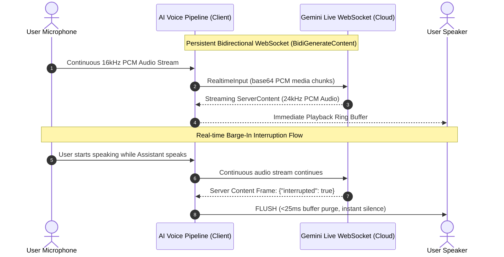

# AI Voice Pipeline 🎙️

> **Universal, low-latency, cloud-orchestrated conversational voice AI pipeline powered by Gemini Live WebSockets.**

[](https://www.python.org/downloads/)
[](LICENSE)
[](#hardware-independence)

AI Voice Pipeline provides an instant, production-grade conversational voice interface. By offloading heavy speech-to-text, reasoning, and voice synthesis to Google's **Gemini Live Multimodal API** (`gemini-3.8-live`), the local client runs with **0% heavy processor load** and **zero multi-gigabyte model weights**.

Any user on Windows, macOS, or Linux can clone the repository, set their API key in `.env`, and converse in real time with sub-500ms turnaround and natural barge-in preemption.

---

## Architecture Overview

Traditional local pipelines require separate VAD, Whisper STT, an LLM, and TTS models running simultaneously, consuming significant CPU/GPU compute and requiring gigabytes of downloaded models.

AI Voice Pipeline connects directly to the bidirectional `BidiGenerateContent` WebSocket endpoint, streaming raw 16kHz audio from the microphone and receiving 24kHz audio from the model within the same persistent connection.



### Architectural Comparison

| Dimension | Local Edge Pipeline (Sonus) | AI Voice Pipeline (Gemini Live) |
| :--- | :--- | :--- |
| **Processor Dependency** | High (Requires AVX2/AVX-512 CPU or discrete GPU) | **Zero (Any basic x86/ARM CPU, Chromebook, Pi)** |
| **Client Memory Footprint** | ~2.5 GB to 4.0 GB RAM | **< 80 MB RAM** |
| **Model Download Size** | ~1.5 GB to 3.0 GB ONNX/CTranslate2 binaries | **0 MB (No model downloads)** |
| **API Configuration** | Complex local Ollama daemon + multiple models | **Single API Key (`GEMINI_API_KEY`) in `.env`** |
| **Barge-in Latency** | Client VAD state machine (~150ms) | **Native Server-Managed Preemption (<25ms flush)** |
| **Setup Time** | 10 to 20 minutes | **< 30 seconds** |

---

## Key Features

- **True Speech-to-Speech Streaming:** Native audio-to-audio understanding preserves emotional cadence, tone, and inflection without text transcoding bottlenecks.
- **Instant Barge-In (<25ms Preemption):** Server-managed interruption frames trigger atomic ring-buffer flushes on the client, stopping assistant speech the moment you speak.
- **High-Fidelity Synthetic Voices:** Seamless support for Google's prebuilt studio voices: `Kore`, `Puck`, `Charon`, `Aoede`, and `Fenrir`.
- **Cross-Platform Portability:** Pure Python networking (`websockets`) and cross-platform audio I/O (`sounddevice`), with native support for Linux PipeWire/ALSA, macOS CoreAudio, and Windows WASAPI.
- **Resilient Reconnection:** Automatic exponential backoff reconnection handling across temporary network jitter or drops.

---

## Quickstart Guide

### 1. Prerequisites
- Python 3.10+ (or [uv](https://github.com/astral-sh/uv))
- A microphone and speaker
- A Gemini API Key from [Google AI Studio](https://aistudio.google.com/) (Free tier available)

### 2. Clone and Install

```bash
git clone https://github.com/aayuxhchaudhary/AI-Voice-Pipeline.git
cd AI-Voice-Pipeline

# Using standard virtual environment:
python3 -m venv .venv
source .venv/bin/activate       # On Windows: .venv\Scripts\activate
pip install -r requirements.txt
```

*(Alternatively, run instantly with `uv run main.py`)*

### 3. Configure `.env`

Copy the template and paste your Google Gemini API key:

```bash
cp .env.example .env
```

Edit `.env`:
```ini
GEMINI_API_KEY=AIzaSy...your_actual_key_here
VOICE_NAME=Kore
GEMINI_MODEL=models/gemini-3.8-live
```

### 4. Run

```bash
python main.py
```

Speak into your microphone naturally. Interrupt at any time by speaking over the assistant.

---

## Configuration Reference

All settings can be specified in `.env` or overridden via CLI flags:

| Environment Variable | CLI Argument | Default | Description |
| :--- | :--- | :--- | :--- |
| `GEMINI_API_KEY` | — | *Required* | API key from Google AI Studio |
| `GEMINI_MODEL` | `--model` | `models/gemini-3.8-live` | Target Gemini Live real-time model ID |
| `VOICE_NAME` | `--voice` | `Kore` | Synthetic voice (`Kore`, `Puck`, `Charon`, `Aoede`, `Fenrir`) |
| `AUDIO_INPUT_DEVICE` | — | `None` (Default) | Hardware index of recording device |
| `AUDIO_OUTPUT_DEVICE` | — | `None` (Default) | Hardware index of playback device |
| `SYSTEM_INSTRUCTION` | — | *Concise Voice Assistant* | Custom prompt defining persona and tone |

### Inspecting Audio Hardware

If your machine has multiple microphones or audio interfaces (e.g., USB headsets, PipeWire sinks), list all detected hardware indices:

```bash
python main.py --list-devices
```

---

## Project Structure

```text
AI-Voice-Pipeline/
├── .env.example              # Clean environment template
├── .gitignore                # Protects secrets, cache, and audio dumps
├── pyproject.toml            # Modern project packaging specification
├── requirements.txt          # Universal dependency manifest
├── README.md                 # Technical architecture and guide
├── main.py                   # Production CLI runner
└── src/
    └── voice_pipeline/
        ├── __init__.py
        ├── config.py         # Configuration loader & fallback .env parser
        ├── audio.py          # PortAudio I/O streams with barge-in flush
        ├── client.py         # Gemini Live WebSocket client & protocol
        └── pipeline.py       # Turn orchestrator with acoustic suppression
```

---

## License

MIT License. Free for open-source and commercial use.
